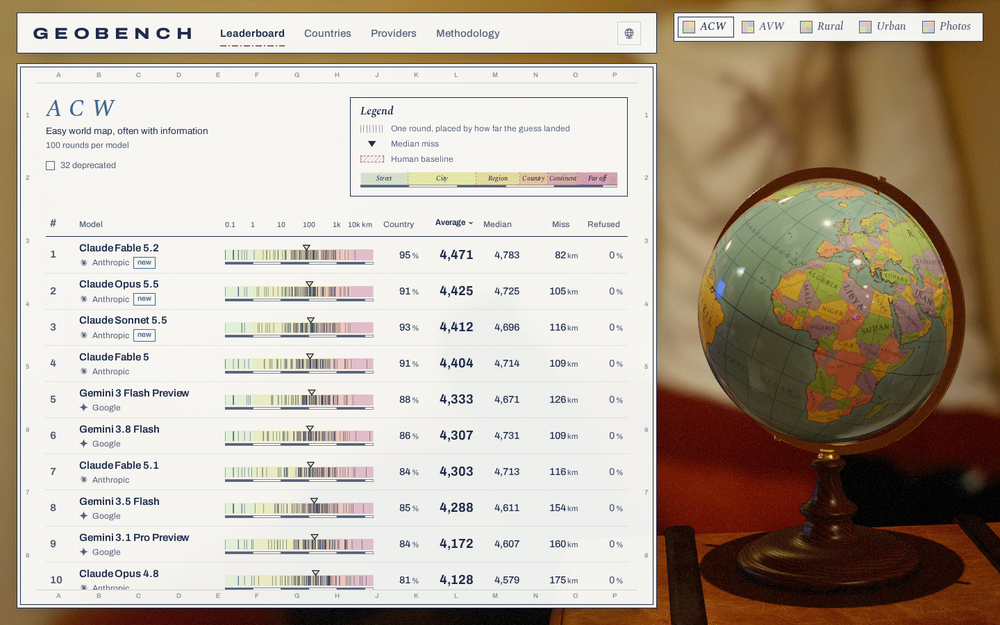
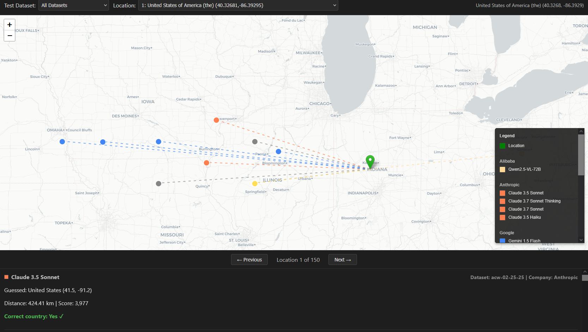

GeoBench is a benchmark for evaluating how well large language models can geolocate images, through the context of GeoGuessr. This project tests whether models can generalize beyond their primary training modalities to perform spatial reasoning tasks.

# **[Leaderboard](https://geobench.org)**


For an in-depth explanation of the results, covering things like model behavior and reasoning, see my [writeup](https://ccmdi.com/blog/GeoBench).

# Installation
Needs [uv](https://docs.astral.sh/uv/).
```bash
git clone https://github.com/ccmdi/geobench.git
cd geobench
uv sync
cp .env.example .env
```
Fill in the key for each provider you want to test in `.env`.

## Test a model
Pick a provider profile from `configs/` and pass the model id with `-m`:
```bash
uv run --env-file .env vf-run @ configs/base.toml @ configs/openai.toml -m <model> --env.taskset.map <map>
```
Profiles: `openai`, `anthropic`, `gemini`, `xai`, `openrouter`. `<map>` is a folder in `dataset/` (default `acw-02-25-25`). Add `-n <locations>` to run only the first few. Traces land in `outputs/<run>/traces.jsonl`.

Each location scores 0 to 5000 points on the GeoGuessr curve, scaled to the map's size. The reward is points / 5000, and `country_correct` tracks whether the country was right.

## Trials and results
Run every location K times with `-r K`. Each trial is its own fresh episode:
```bash
uv run --env-file .env vf-run @ configs/base.toml @ configs/openai.toml -m <model> -r 3
```
Then build the report from one or more run folders. It only reads the saved traces, so no model gets called:
```bash
uv run python -m shungite.report outputs/<run> [outputs/<run> ...]
```
You get Markdown tables: per model, the pass rate, pass^k, pass@k, mean score (points / 5000) with its spread across trials, tokens and wall time, then every location's score in each trial. `--price-in` / `--price-out` (USD per 1M tokens) turn the tokens into a cost, and `--json` prints the numbers as JSON. A location passes when the country is right.

## Create a dataset
```bash
uv run --extra build python dataset.py --num <n> --output <map> --map <geoguessr map id>
```
This needs `NCFA` in `.env`. Instructions for setting it up can be found [here](https://github.com/EvickaStudio/GeoGuessr-API?tab=readme-ov-file#authentication).

## Compare guesses
Running the `browser/main.py` script and opening `visualization.html` can show you all guesses for a location made by the models.


